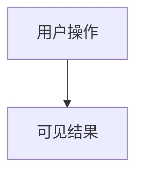

# 产品 PRD 模板（product-prd）

默认用于模式四 4B、Full / Standard / Lightweight 路径的产品评审交付。内容遵循 `references/chinese-writing-style.md`。产出后运行 `node scripts/validate-prd.js <path>`；默认 profile 为 `product-prd`，error 清零。用户可观察验收标准属于产品内容。

HTML 原型交付时，产品 PRD 放在第一个视图并默认展示；注释遵循 `references/html-annotation-system.md`。接口、错误码、代码路径、实现步骤、测试命令须单独交付工程规格，不写入产品 PRD 或产品注释。

---

# {功能/页面名} · 产品 PRD

> 版本 v{1.0} · 负责人：{PM} · 关联需求：{需求号} · 更新：{变更摘要}

## 1. 需求概要

### 1.1 背景（RC-10）
{现状痛点，回答为什么做。}

### 1.2 目标（RC-11）
{可衡量目标。}

### 1.3 用户与场景（PRD-USERS）
{谁在什么情况下需要完成什么任务。}

### 1.4 范围与非目标（PRD-SCOPE）
{本期包含什么；明确不包含什么。}

### 1.5 方案（RC-20）
{功能清单与方案概述。}

### 1.6 竞品/现状对比（RC-13）
### 1.7 预期收益（RC-12）
### 1.8 成本测算（RC-14，如适用）

## 2. 文档信息（RC-01）

| 项目 | 内容 |
|------|------|
| 页面/功能名称 | {名称} |
| 业务对象 | {一条记录代表什么} |
| 数据入口 | {入口及业务筛选条件} |
| 权限 | {可见范围、操作权限；无则写全量可见} |

### 修订记录（RC-02）
{版本、修订人、日期、描述。}

## 3. 页面结构（RC-21）

```
{页面名}
├── {区域 1：组件与可选项}
└── {区域 2}
```

## 4. 状态流转（RC-22）

{用户可见状态、迁移条件、终态和不可逆规则；不使用内部枚举。}

## 5. 业务流程与交互详述（RC-23~26）



{每个功能的触发、行为、可见状态、异常分支；与图中分支对应。复用流程注明来源及改动范围。}

## 6. 业务数据字段（RC-30）

| 字段 | 类型 | 必填 | 说明 |
|------|------|:----:|------|
| {中文业务名称} | {文本/日期/选项等业务类型} | 是/否 | {含义、取值、默认值与业务边界} |

{描述用户输入或可见信息，不定义数据库模型或接口参数。}

## 7. 验收标准（RC-40、PRD-AC）

- AC-01 {用户操作或场景} → {用户可观察的预期结果}
- AC-02 {边界场景} → {可见结果}
- AC-03 {异常场景} → {提示与恢复行为}

一条一验，覆盖正常、边界、异常。自动校验检查 AC 标识与可观察结果表达；评审人工确认场景、结果和覆盖完整性。测试执行命令归工程验证交付。

## 8. 数据需求（RC-32~33，如适用）

{业务指标、埋点目的与报表要求。}

## 9. 上线/下线需求（RC-41~42，如适用）

{用户可用范围、发布时机、存量数据与用户行为变化。}

## 10. 运营计划（RC-50，如适用）

## 11. 风险分析（RC-51）

| 风险 | 影响 | 应对 |
|------|------|------|
| {风险} | {影响} | {应对} |

## 12. 相关文档（RC-52）

{关联产品需求、原型与决策记录。}

---

## 已确认 PRD 的局部变更

继承已确认事实、范围、约束和决定，只核对变更影响的规则、状态、异常、打扰风险与验收标准，不重问全量摄入信息。用户已明确要求的变更直接采用；仅对新出现且会改变当前交付的未决项每轮问一个问题。更新所有受影响章节和旧 AC，保留未变化内容与稳定标识，记录变更前后差异；受影响旧 AC 未更新或阻塞未决时不得宣称已就绪。

每个仍存在的未决项必须在回复与工件中单独标注状态：会改变当前交付或验收结果的列为**阻塞**（不得称已就绪，逐项说明影响并提供最小确认方式）；其余未知项列为**待验证**（不影响当前交付，注明边界）。回复只列关键未决项并给状态，不在回复正文展开非关键清单。

## 显式工程规格与兼容边界

仅在用户明确要求接口、实现或工程验证规格时，单独生成 `engineering-spec` 文档并运行 `node scripts/validate-prd.js <engineering-path> --profile engineering-spec`。产品章节沿用上述结构；工程文档另增「接口需求」（RC-31：method + path，评审核对参数、返回、错误码）和「开发注意事项」（RC-43），按需包含代码路径、实现步骤与测试命令。它们不成为默认产品 PRD 的缺失 error。

`--profile legacy` 仅用于读取既有研发 PRD，保留原 RC-01~52 规则与严重级别。不能作为默认产品生成模板，也不因输入出现工程内容自动切换。JSON 校验报告明确返回实际 profile。产品 PRD 混入工程内容时，PRD-BOUNDARY 阻断并提示拆分到显式工程规格。

产品三文档来源：背景、目标、范围与验收来自 proposal；业务对象、交互与状态来自产品 design。工程 design/tasks 需要显式交付层，不合并到产品 PRD。
