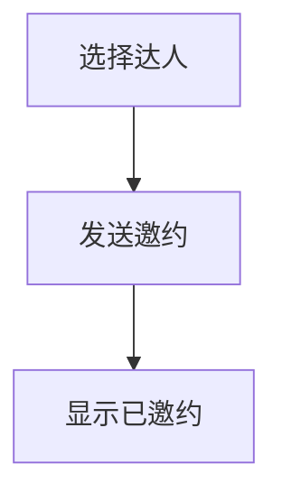

# 邀约合作 · 产品 PRD

> 版本 v1.0 · 负责人：产品经理 · 关联需求：R003

## 文档信息
页面/功能名称：邀约合作
修订记录：v1.0 初稿

## 背景
媒介在提报达人后才发现对方没有合作意愿，需要重新筛选与沟通，导致无效提报和任务延误。先确认意愿可以减少返工。

## 目标
一个月内无效提报减少 30%。

## 用户与场景
媒介为招募任务筛选达人时确认合作意愿。

## 范围与非目标
本期提供邀约列表和意愿标记；不包含自动推荐达人。

## 方案与交互详述
媒介选择达人后发送邀约；成功显示已邀约，失败提示重试，保留原记录。
权限：仅负责人可操作，其他媒介可查看。
复用声明：复用已有达人选择流程。
现状对比：现有提报流程缺少意愿确认。
预期收益：减少 30% 无效提报。

## 页面结构
邀约页面
├── 达人列表
└── 发送邀约按钮

## 状态流转
未邀约 → 已邀约 → 可合作；不可合作为终态，不能再次发送。

## 业务流程

## 数据字段
| 字段 | 类型 | 必填 | 说明 |
|------|------|------|------|
| 达人姓名 | 文本 | 是 | 用于识别邀约对象 |

## 验收标准
- AC-01 选择达人并确认发送 → 页面显示已邀约。
- AC-02 未选择达人发送 → 提示先选择达人，不执行发送。
- AC-03 发送失败 → 提示重试，记录保持未邀约。

## 风险分析
误操作导致重复联系；确认发送前显示达人姓名。
